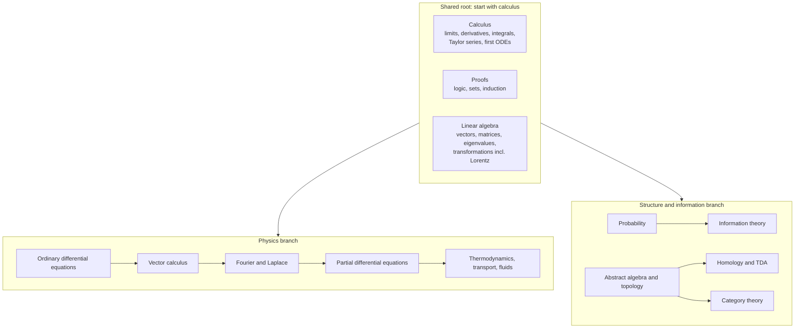
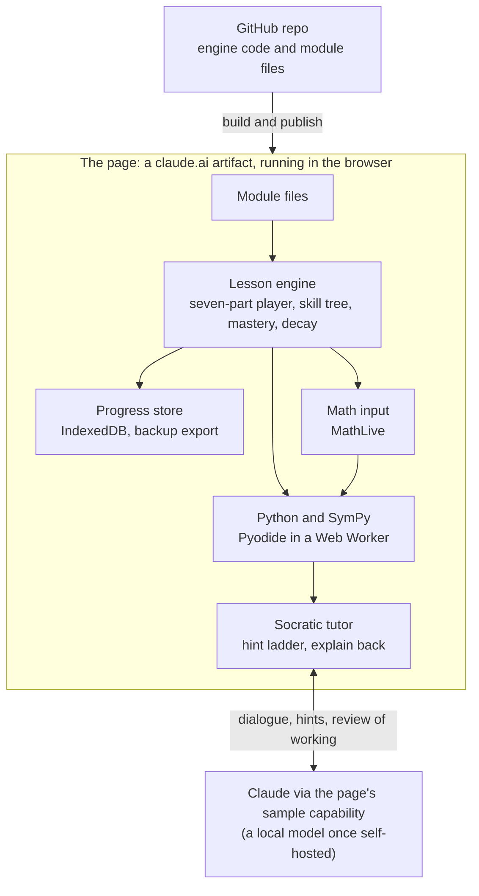

# Project Aryabhata — Curriculum & System Design

Specification, version 1 · 11 October 2026 · Gsub

## Purpose and requirements

Project Aryabhata is a personal, gamified system that takes me from rusty calculus to intuitive fluency in the maths behind physics, data and abstract structure. The test of success: I see a problem and know how to attack it, without looking up the equation.

**Why it matters**

- Hold my own in conversations that reach for TDA, category theory, probability and information theory.

- Use that maths directly in my own engineering and research work.

- Later, teach all of it to Sara, well ahead of her peers.

**Decisions so far**

| Area                        | Decision                                                                                       |
|-----------------------------|------------------------------------------------------------------------------------------------|
| Goal                        | Intuition and fluency, not exam speed. No JEE-style timed drilling.                            |
| Starting point              | Calculus from the very beginning; everything is treated as rusty.                              |
| Learning loop               | Derive by hand, build it in code, watch it behave, revisit until it is reflex.                 |
| Proofs                      | Yes, introduced gradually as the curriculum grows.                                             |
| Order                       | Maths foundations first; then the physics and structure-and-information branches, interleaved. |
| Motivation                  | A sense of craft and the need to learn. No cheap rewards.                                      |
| Retention                   | Spaced repetition with mastery decay: skills go rusty if unused.                               |
| Math input                  | In the browser, no LaTeX knowledge needed. Paper derivations also supported.                   |
| Code                        | Python, with code assist. The aim is maths, not Python.                                        |
| Tutor                       | Socratic from day one: hints and questions, never just answers.                                |
| Hosting                     | A claude.ai artifact link for now, code mirrored to Gsub's GitHub repo; private hosting later. |
| Relation to Sara's platform | A separate system.                                                                             |
| Build pace                  | Slowly, one module at a time. Never the whole system at once.                                  |

## Learning philosophy

Every idea passes through four stages: see it, derive it, build it, keep it. Intuition comes from doing all four, not from reading.

1.  **See it.** Start from a picture or a physical question, never a definition. Example: what does the slope of a curve at a single point even mean?

2.  **Derive it.** Work it out by hand with scaffolding that fades. Early modules give me most of each step to fill in. Later modules give a blank page.

3.  **Build it.** Write a small piece of Python that computes or simulates the idea. Make a prediction first, then run it and compare.

4.  **Keep it.** Spaced review brings the idea back days and weeks later, in new disguises, until recall is instant.

**Principles**

- **Why before how.** Every formula is derived before it is used. Nothing is memorised that hasn't been understood.

- **Predict before reveal.** Guessing first, then checking, is what turns knowledge into intuition.

- **Mistakes are material.** Wrong steps get a question from the tutor, not a red cross.

- **Small, finished modules.** Each module is complete in itself, so the system is useful from module 1.

- **One idea, many views.** The same concept shows up geometrically, algebraically, numerically and physically. Example: the derivative as slope, as a limit, as a finite difference in code, and as velocity.

## Curriculum map

Calculus comes first and unlocks everything else; proofs and linear algebra complete the shared root.



The branches meet again later. Entropy is the same idea in thermodynamics and in information theory, and linear algebra underpins both PDEs and TDA. Each box is a cluster of modules, unlocked node by node.

## Module anatomy

Every module follows the same seven-part shape, so the system can grow one module at a time without redesign. A module covers one idea and takes roughly one to three sessions.

1.  **Hook.** A question or picture that makes the idea necessary. Example: how fast is a falling stone moving at exactly t = 2 seconds?

2.  **Explore.** An interactive visual to play with before any formula. Example: drag a secant line until it becomes a tangent.

3.  **Derive.** A guided derivation entered step by step in the browser. Each step is checked symbolically. The scaffolding fades across the module.

4.  **Build.** A short Python notebook cell: predict the output, run it, compare, then change something and predict again.

5.  **Practise.** Problems that grow from routine to unfamiliar. The tutor gives hints, never solutions, until I ask.

6.  **Explain back.** I explain the idea in my own words. The tutor probes for gaps.

7.  **Mastery check.** A short set that unlocks the next nodes and schedules the first spaced review.

Modules are plain data files (content, problems, checks), separate from the engine. Adding module 12 means writing one file, not changing code.

## Game mechanics

The game rewards craft: visible mastery that is earned, can fade, and has to be maintained. There are no points for logging in and no streak guilt.

| Mechanic       | How it works                                                                                         | Why it fits                                                       |
|----------------|------------------------------------------------------------------------------------------------------|-------------------------------------------------------------------|
| Skill tree     | The curriculum map is the game board. Nodes unlock when their prerequisites reach mastery.           | Shows exactly where I stand and what is next.                     |
| Mastery levels | Each node moves through Seen, Derived, Built, Fluent, and finally Can Teach It.                      | Mirrors the learning loop; each level means a real capability.    |
| Decay          | A node's mastery fades on a spaced-repetition schedule. Rusty nodes glow and need a short refresher. | Keeps skills at the fingertips, as a craftsman keeps tools sharp. |
| Boss fights    | Capstone problems that combine several nodes, derived and simulated end to end.                      | The real test of understanding; a satisfying milestone.           |
| Workshop       | A personal gallery of every simulation and derivation I have built.                                  | The visible body of craft. Later, Sara's teaching material.       |
| Personal bests | Fewer hints needed, cleaner derivations, faster recall over time. Only compared with my past self.   | Progress without leaderboards.                                    |

The daily loop is short: clear rusty nodes first, up to a daily cap so review never becomes a chore, then continue on the frontier of the tree. A session can be ten minutes of review or two hours of building.

## Socratic tutor

The tutor asks, it doesn't tell. Two parts split the work: a language model handles the conversation, and a symbolic math engine (SymPy) decides what is correct.

**Why split it.** Language models are good teachers but can confidently approve a wrong step. SymPy checks algebra and calculus deterministically. So the tutor never marks a wrong step right.

**Hint ladder.** When I'm stuck, help escalates one rung at a time:

1.  A question that points at the right idea.

2.  A related, simpler example.

3.  The name of the technique to use.

4.  The first line of the step.

5.  The full step, with an explanation. Using this rung is recorded, and the problem comes back later.

**Other behaviours**

- After a wrong step, it asks what I expected to happen, rather than naming the error.

- In Explain back, it plays a curious student and asks why at each claim.

- It knows which nodes I have mastered and uses them in explanations.

- For paper derivations, I photograph the page and it reviews the working line by line.

**Where it runs.** In the claude.ai version, the tutor uses Claude from inside the page. In the later self-hosted version, it can switch to a local model for fully offline use. SymPy runs in the browser in both.

## System architecture

The whole system is one web page published as a claude.ai artifact, with Python running inside the browser. Only the tutor's language model lives outside the page.



- **Python in the browser.** Pyodide runs NumPy, SymPy and Matplotlib directly in the page, so there is no server to maintain.

- **Modules as data.** The engine never changes when a module is added; only a new file appears in the repo.

- **Progress.** Kept in the artifact's own storage and exportable as a file to GitHub, so nothing is ever lost.

- **Moving later.** Because the page is self-contained, self-hosting means serving the same files and swapping Claude for a local model.

The exact libraries, page capabilities and storage design are in the technical specification below.

## Sources

Each area gets one main book plus one source built for intuition. The system's modules are original; these are for going deeper. Free sources are preferred so they can be kept offline.

| Area                 | Source                                                                    | Role                                     | Free                  |
|----------------------|---------------------------------------------------------------------------|------------------------------------------|-----------------------|
| Calculus             | Gilbert Strang, *Calculus* (MIT OpenCourseWare)                           | Main text                                | Yes                   |
| Calculus             | 3Blue1Brown, *Essence of Calculus*                                        | Visual intuition                         | Yes (video)           |
| Proofs               | Richard Hammack, *Book of Proof*                                          | Learning to read and write proofs        | Yes                   |
| Linear algebra       | Gilbert Strang, *Introduction to Linear Algebra*, with MIT 18.06 lectures | Main text                                | Lectures yes, book no |
| Linear algebra       | 3Blue1Brown, *Essence of Linear Algebra*                                  | Visual intuition                         | Yes (video)           |
| Engineering maths    | Mary Boas, *Mathematical Methods in the Physical Sciences*                | Spine for ODEs, series, transforms, PDEs | No                    |
| Complex numbers      | Tristan Needham, *Visual Complex Analysis*                                | Intuition behind Fourier and Laplace     | No                    |
| Dynamics             | Steven Strogatz, *Nonlinear Dynamics and Chaos*                           | ODEs as geometry                         | No                    |
| Transport and fluids | Bird, Stewart and Lightfoot, *Transport Phenomena*                        | Physics capstone                         | No                    |
| Probability          | Blitzstein and Hwang, *Introduction to Probability*                       | Main text                                | Yes                   |
| Information theory   | David MacKay, *Information Theory, Inference, and Learning Algorithms*    | Main text                                | Yes                   |
| Topology and TDA     | Robert Ghrist, *Elementary Applied Topology*                              | Applied, visual route into homology      | No                    |
| Category theory      | Fong and Spivak, *Seven Sketches in Compositionality*                     | Applied introduction                     | Yes                   |
| Category theory      | Bartosz Milewski, *Category Theory for Programmers*                       | The engineer's door in                   | Yes                   |

Availability is from memory; each will be checked when its module is built.

## Build roadmap

The first build is one complete module, not a framework. Real use of that module decides how the rest is built.

1.  **Walking skeleton.** Module 1 with all seven parts: browser math input, in-browser Python, SymPy step checks, a basic Socratic tutor, saved progress. Code pushed to GitHub.

2.  **Use it for a week.** Gsub works through Module 1; we fix the module anatomy based on what felt right or wrong.

3.  **The game layer.** The skill tree view, mastery levels, and the decay and review queue.

4.  **The calculus root, one module at a time.** See the list below.

5.  **Paper derivations.** Photo upload with line-by-line review.

6.  **Linear algebra and proofs.** The rest of the shared root.

7.  **Branches.** Physics and structure-and-information branches, interleaved, then self-hosting and an offline tutor.

**Calculus root, in order**

1.  Limits: what "approaching" really means, with functions and plotting refreshed along the way

2.  The derivative as a slope at a point

3.  Deriving the rules: power, product, quotient, chain

4.  Exponentials, logarithms and trigonometric functions

5.  Using derivatives: optimisation, rates, linear approximation

6.  Taylor series: every smooth function is locally a polynomial

7.  The integral as accumulation

8.  The fundamental theorem of calculus

9.  Integration techniques: substitution, parts, partial fractions

10. Using integrals: areas, volumes, work, averages

11. First differential equations: growth, decay, cooling

Boss fight for the calculus root: model a cooling cup of tea from scratch, derive Newton's law of cooling, solve it by hand and numerically, and compare with a real measurement.

## Settled questions

All five are settled.

| Question                    | Decision                                                                                   |
|-----------------------------|--------------------------------------------------------------------------------------------|
| Main device                 | Laptop.                                                                                    |
| Branch order after the root | Interleaved; both branches matter.                                                         |
| Where progress lives        | In the artifact's storage on the laptop.                                                   |
| Daily review cap            | Yes.                                                                                       |
| Who sees progress           | Private, for Gsub alone. The design carries no company references, so it can be published. |

## Technical specification

Everything above is the design. Everything from here down is the build spec: precise enough to implement Module 1 from, and to keep the system consistent as modules are added.

**Scope of version 1**

- A single-user web app, published as a claude.ai artifact and used on a laptop.

- The full seven-part module player, step checking, the Socratic tutor, mastery and review, and the skill tree.

- Content: the calculus root, written one module at a time.

**Non-goals for version 1**

- No accounts, multiple users, sharing of progress or leaderboards.

- No timed drills or speed scoring.

- No server of its own. All computation runs in the browser.

- No LaTeX knowledge required of the learner.

- No phone layout; laptop first, tablet a later nicety.

**Glossary**

| Term           | Meaning                                                                               |
|----------------|---------------------------------------------------------------------------------------|
| Node           | One box of the skill tree. Usually one module.                                        |
| Module         | The content file for a node: its seven parts, problems and checks.                    |
| Step           | One line of a derivation, entered by the learner and checked.                         |
| Verdict        | The step checker's judgement on a step, such as equivalent or not equivalent.         |
| Rung           | One level of the hint ladder, from 1 (a question) to 5 (the full step).               |
| Stability      | How many days a node's memory is expected to last; grows with each successful review. |
| Retrievability | The estimated chance, between 0 and 1, of recalling a node right now.                 |
| Rusty          | A node whose retrievability has dropped below the review threshold.                   |

## Runtime platform

The app is one HTML page, published as a private claude.ai artifact. Libraries load from the CDNs that artifacts allow; nothing else is fetched at runtime.

| Component         | Choice                          | Loaded from                   | Purpose                                                                   |
|-------------------|---------------------------------|-------------------------------|---------------------------------------------------------------------------|
| Math input        | MathLive (`math-field` element) | cdn.jsdelivr.net/npm/mathlive | Visual equation entry; emits LaTeX and MathJSON                           |
| Python            | Pyodide                         | cdn.jsdelivr.net/npm/pyodide  | Runs Python, NumPy, SymPy and Matplotlib in the page, inside a Web Worker |
| Symbolic checking | SymPy (in Pyodide)              | With Pyodide                  | Step verdicts, problem answers                                            |
| Code editor       | CodeMirror 6                    | cdn.jsdelivr.net/npm          | Python cells in the Build part                                            |
| Math display      | KaTeX                           | cdnjs.cloudflare.com          | Fast rendering of read-only formulas                                      |
| Explore widgets   | Plain SVG and JavaScript        | Inline                        | Interactive visuals (secant to tangent, zoom, and so on)                  |
| Persistence       | IndexedDB                       | Browser                       | Progress, workshop items, review schedule                                 |

**Page capabilities declared on publish**

| Capability  | Config           | Used for                                                                                             |
|-------------|------------------|------------------------------------------------------------------------------------------------------|
| `sample`    | `{images: true}` | The Socratic tutor, explain-back marking and photo review. Calls Claude from the page as the viewer. |
| `downloads` | `true`           | Saving the progress backup file to the laptop.                                                       |

Both are reached with `await claude.use(name)`. When either resolves to `null` (for example, consent declined), the feature degrades as described under the tutor protocol and storage sections; the rest of the app keeps working.

**Python execution.** Pyodide runs in a dedicated Web Worker so long computations never freeze the page. The worker exposes three calls: `check(stepRequest)`, `run(code)` and `plot(code)`. Each run has a 10-second timeout; on timeout the worker is restarted. Matplotlib output is returned as a PNG data URL.

## Repository layout

Source lives in GitHub as small files; a build step inlines them into the one page that gets published.

```
project-aryabhata/
  SPEC.md                  this specification
  CLAUDE.md                project guide for Claude Code sessions
  STATUS.md                milestone and task status
  .claude/agents/          architect, professor, engineer, systems-tester
  docs/decisions/          architecture decision records
  docs/pedagogy/           authoring guide, misconception catalogue
  schemas/                 JSON Schemas for curriculum and module files
  tree/curriculum.json     nodes, prerequisites, positions on the map
  modules/
    calculus/01-limits.json
    calculus/02-derivative.json
  src/
    app.js                 routing and screens
    engine/                module player, mastery, unlock, review queue
    checker/               worker host; checker.py; mathjson_to_sympy.py
    tutor/                 prompt builders, response parsing, hint ladder
    store/                 IndexedDB access, backup export and import
    widgets/               explore widgets, one file each
    ui/                    styles and shared components
  tools/build.mjs          inlines src, tree and modules into dist/index.html
  tests/
    checker/               pytest suite run under normal CPython
    engine/                mastery and scheduling tests
    tutor/                 tutor evaluation set and scorer
    e2e/                   Playwright flows against the dev build
  dist/index.html          the published page (build output)
```
      tests/
        checker/               pytest suite run under normal CPython
        engine/                mastery and scheduling tests
      dist/index.html          the published page (build output)

**Flow.** Edit files, run the tests, run `node tools/build.mjs`, publish `dist/index.html` to the same artifact URL, commit. Republishing to the same URL keeps the browser's stored progress.

**Rules**

- Module files contain content only, never code. A new module is one new JSON file plus one entry in `curriculum.json`.

- Every module ships with checker tests: each expected step and answer must pass, and each listed wrong answer must fail.

- The checker is plain Python, so it is tested outside the browser exactly as it runs inside it.

## Content schema

**Curriculum tree.** `tree/curriculum.json` lists every node: its id, title, branch (`root`, `physics` or `structure`), cluster, prerequisite node ids, and a position on the map. A node with no module file yet shows on the map as "coming soon".

**Module file.** One JSON file per module, following the seven-part anatomy. A shortened example:

``` json
{
  "id": "calc.limits",
  "version": 1,
  "title": "Limits: what approaching really means",
  "prereqs": [],
  "objectives": ["Explain a limit in words and pictures", "Evaluate limits by algebra"],
  "hook": { "text": "How fast is a falling stone moving at exactly t = 2 s?" },
  "explore": [
    { "widget": "secant-to-tangent", "params": { "f": "5*t**2", "a": 2 },
      "predict": "What will the average speed approach as the interval shrinks?" }
  ],
  "derive": [
    { "id": "d1", "goal": "\\lim_{x\\to2}\\frac{x^2-4}{x-2}",
      "start": "(x**2-4)/(x-2)", "point": 2,
      "steps": [
        { "expected": "(x-2)*(x+2)/(x-2)", "scaffold": "fill",
          "hints": ["What does the numerator look like?", "Try a smaller example: x^2-9.",
                    "Difference of squares.", "x^2-4 = (x-2)(...)"] },
        { "expected": "x+2", "scaffold": "blank", "note": "valid for x != 2" }
      ],
      "answer": "4" }
  ],
  "build": [
    { "predict": "What happens to the difference quotient as h gets extremely small?",
      "starter": "f = lambda t: 5*t**2\nfor h in [1, 0.1, 0.01]:\n    print(h, (f(2+h)-f(2))/h)",
      "reveal": "Accuracy improves, then collapses near h = 1e-15: floating-point cancellation." }
  ],
  "practise": [
    { "id": "p1", "difficulty": 1, "prompt": "\\lim_{x\\to3}\\frac{x^2-9}{x-3}",
      "answer": "6", "wrong": ["0", "undefined"], "hints": ["..."] }
  ],
  "explain": { "prompt": "Explain to a curious 12-year-old why 0/0 is not the answer.",
    "rubric": ["approach vs arrive", "value at the point is irrelevant", "uses an example"] },
  "mastery": { "items": ["p3", "p5", "p7", "p8", "p10"], "pass": 4 },
  "review_pool": ["p2", "p4", "p6", "p9"]
}
```

**Field rules**

- Math in prompts is LaTeX (rendered by KaTeX). Math that the checker compares is SymPy syntax, so content authors never depend on parsing LaTeX.

- `scaffold` is `given` (step shown), `fill` (step shown with a gap) or `blank` (empty input). Scaffolding must fade within a module: givens first, blanks last.

- Hints hold rungs 1 to 4. Rung 5, the full step, is always `expected` with its `note`. Authored hints guarantee correctness; the tutor may paraphrase them but not replace them.

- `wrong` lists plausible wrong answers. Tests assert each one fails, and the tutor uses them to spot known misconceptions.

## Step checking

The checker decides correctness. The tutor never does.

**Pipeline**

1.  The learner types a step in a MathLive field.

2.  The page reads the field as MathJSON, a structured tree, rather than LaTeX.

3.  The worker converts MathJSON to a SymPy expression with `mathjson_to_sympy.py`. It supports numbers, symbols, the four operations, powers, roots, `exp`, `ln`, `log`, trig and inverse trig, absolute value, equations, limits, derivatives and integrals. Anything else returns `unparseable`.

4.  The checker compares the new step with the previous step and with the module's expected step, then returns a verdict.

**Equivalence test**, in order:

1.  Symbolic: `simplify(a - b) == 0`, with a 2-second budget.

2.  Numeric fallback: evaluate both at 24 random points in the step's domain and accept if all agree within a relative tolerance of 1e-9.

3.  Punctured neighbourhoods: inside a limit, steps only need to agree near the limit point, not at it. Sample points avoid the point itself, so cancelling (x - 2) is accepted, and the result carries a `removable_point` flag the tutor can ask about.

**Verdicts**

| Verdict                  | Meaning                                           | What the learner sees                            |
|--------------------------|---------------------------------------------------|--------------------------------------------------|
| `equivalent_progress`    | Equal to the previous step and closer to the goal | A green tick; move on                            |
| `equivalent_no_progress` | Equal, but no simpler                             | A neutral nudge from the tutor                   |
| `target_reached`         | Matches the module's final answer                 | Completion of the derivation                     |
| `not_equivalent`         | Not equal to the previous step                    | A Socratic question, never a red cross           |
| `unparseable`            | Cannot be read                                    | A request to re-enter, with the reason           |
| `timeout`                | No decision within budget                         | Accepted provisionally and flagged for the tutor |

Every verdict includes the SymPy forms of both sides and, for `not_equivalent`, one sample point where they differ. That point is what the tutor builds its question on.

## Mastery and review

**Levels.** Each node holds one level, earned in order.

| Level            | Earned when                                                                |
|------------------|----------------------------------------------------------------------------|
| 0\. Locked       | A prerequisite is below Built.                                             |
| 1\. Seen         | Hook and Explore completed, including the predictions.                     |
| 2\. Derived      | Every derivation completed using no hint above rung 3.                     |
| 3\. Built        | Every Build cell run, with a prediction recorded first.                    |
| 4\. Fluent       | Mastery check passed, then two spaced reviews passed.                      |
| 5\. Can teach it | Explain back scores at least 3 of the rubric points after reaching Fluent. |

**Unlocking.** A node unlocks when every prerequisite reaches Built. Boss fights unlock only when every node they draw on is Fluent.

**Decay model.** From level 2 upward, each node has a stability `S` in days and a last review time. Retrievability is `R = exp(-t / S)`, where `t` is days since that review. A node turns rusty when `R` falls below 0.85.

- New node at Derived: `S = 2`.

- Review passed: `S = S * g`, where `g` is 2.5 with no hints, 1.8 with rungs 1 to 2, and 1.3 with rungs 3 to 4.

- Review failed or rung 5 used: `S = max(1, S * 0.5)`.

- Two consecutive failed reviews drop the node one level, never below Derived.

Rusty nodes stay at their level; they glow on the map. Decay costs effort, not earned standing.

**A review item** is one practice problem drawn from the node's `review_pool`, never the same one twice in a row, so recall is tested in a new disguise.

**Daily cap.** At most 8 review items a day by default, adjustable in settings. When more nodes are rusty, the lowest `R` goes first and the rest wait. Reviews never block new learning: the Continue button is always available.

## Tutor protocol

The tutor is called through the page's `sample` capability. Each call is memoryless, so every request carries the full context it needs.

**Request.** A fixed system instruction plus one JSON context object:

``` json
{
  "mode": "step",
  "module": "calc.limits",
  "task": "d1",
  "goal": "\\lim_{x\\to2}\\frac{x^2-4}{x-2}",
  "history": ["(x**2-4)/(x-2)"],
  "attempt": "(x-2)*(x-2)/(x-2)",
  "verdict": { "type": "not_equivalent", "witness": { "x": 3, "lhs": 5, "rhs": 1 } },
  "max_rung": 1,
  "authored_hints": ["What does the numerator look like?"],
  "known_misconceptions": ["(a-b)^2 confused with a^2-b^2"],
  "mastered_nodes": [],
  "recent_dialogue": []
}
```

**Response.** Read with `sample.json`, so it arrives as structured data:

``` json
{ "message": "Try x = 3 in your line and in the original. Do they agree?",
  "rung": 1, "misconception": "(a-b)^2 confused with a^2-b^2", "expects_reply": true }
```

**Modes.** `step` (a derivation step), `stuck` (the learner asks for help), `problem` (a practice answer), `explain` (explain-back dialogue and rubric scoring), `photo` (paper review) and `chat` (a free question about the current module).

**Rules in the system instruction**

1.  Never contradict the verdict. If it says not equivalent, the step is wrong, whatever it looks like.

2.  Never exceed `max_rung`. The page raises the rung only when the learner asks for more help.

3.  Prefer questions to statements. Build questions on the verdict's sample point when there is one.

4.  Use only nodes in `mastered_nodes` when referring to earlier ideas.

5.  Keep replies to three sentences or fewer, except in explain mode.

6.  In explain mode, act as a curious student and return a rubric score with one-line evidence per point.

**Photo review.** A photo of handwritten working is sent with `mode: "photo"` and asks for a transcription only: an ordered list of steps in SymPy syntax. Each step then goes through the step checker exactly as typed steps do. A second call writes the feedback from those verdicts. Transcription is shown to the learner for correction before checking.

**Model tier.** `default` for step, stuck, problem and chat; `complex` for explain and photo.

**When the tutor is unavailable** (no consent, rate limited, offline): steps are still checked, authored hints are shown rung by rung, explain-back is saved for later scoring, and a small banner says the tutor is off. Rate limits back off and never retry in a loop.

## Progress storage

Progress lives in the browser's IndexedDB on the laptop, as decided. Browser storage can be cleared, so backups are built in.

**Stores**

| Store      | Key     | Holds                                                               |
|------------|---------|---------------------------------------------------------------------|
| `nodes`    | node id | Level, stability, last review, review history, consecutive failures |
| `attempts` | auto    | Every step and answer: input, verdict, rung used, time              |
| `workshop` | auto    | Saved derivations, code, plot images and explanations               |
| `settings` | key     | Daily cap, review threshold, tutor on or off                        |
| `meta`     | key     | Schema version, last backup time                                    |

**Backup.** One button saves the whole database as `aryabhata-backup-YYYY-MM-DD.json` through the `downloads` capability. The app suggests a backup after every completed module and whenever the last one is over seven days old. Import restores from that file after showing what it contains.

**Versioning.** Every backup carries the schema version. Module files carry their own version; when a module changes, progress on it is kept and only new tasks show as unattempted.

The backup file can also be committed to the GitHub repo by hand, which gives a history of progress for free.

## Screens

| Screen         | What it shows                                                               | Main actions                                            |
|----------------|-----------------------------------------------------------------------------|---------------------------------------------------------|
| Home: the map  | The skill tree with each node's level and rust; today's review count        | Start review, Continue, open any unlocked node          |
| Module player  | The seven parts as a stepper; content on the left, tutor panel on the right | Predict, enter steps, ask for a hint, run code, explain |
| Review session | One review item at a time, up to the daily cap                              | Answer, ask for a hint, skip to tomorrow                |
| Boss fight     | A capstone brief, a derivation space and a notebook                         | Derive, simulate, submit for tutor review               |
| Workshop       | A gallery of everything built, filterable by node                           | Open, re-run, add a note                                |
| Settings       | Daily cap, threshold, tutor status, backup and import                       | Change values, back up, restore                         |

**The daily flow**

1.  Open the app. Home shows the map and, if anything is rusty, "3 reviews today".

2.  Clear reviews, or skip straight to Continue.

3.  Continue opens the frontier node at the part where it was left.

4.  Finishing a module shows the level gained, the node lighting up, and a backup prompt.

**Design notes.** Laptop layout, light and dark themes, keyboard first: Enter checks a step, a shortcut asks for a hint, another runs the code cell. No sounds, confetti or badges; the map lighting up is the reward.

## Module 1: Limits

**Objectives.** By the end I can say what a limit means without symbols, evaluate limits by algebra, recognise when a limit does not exist, and explain why the value at the point itself is irrelevant.

| Part                        | Content                                                                                                                                                                                                                 |
|-----------------------------|-------------------------------------------------------------------------------------------------------------------------------------------------------------------------------------------------------------------------|
| Hook                        | A stone falls with distance 5t². Its average speed over any interval is easy. What is its speed at exactly t = 2? Dividing 0 by 0 gives nothing.                                                                        |
| Explore 1                   | Secant to tangent: drag the second point towards t = 2 and watch the average speed settle. Predict the number first.                                                                                                    |
| Explore 2                   | Zoom in: keep magnifying a smooth curve around a point until it looks straight. Then try a curve with a corner and see it never straightens.                                                                            |
| Explore 3                   | The ε-δ game, an optional first taste of proof: the computer names a tolerance ε around the limit; I choose a δ that keeps the function inside it. Win every round and the limit is proved.                             |
| Derive 1 (given, then fill) | lim x→2 of (x² − 4)/(x − 2): factor, cancel, substitute. The tutor asks why cancelling is allowed.                                                                                                                      |
| Derive 2 (fill)             | lim h→0 of ((2 + h)² − 4)/h: expand, simplify, take the limit. Connects back to the stone.                                                                                                                              |
| Derive 3 (blank)            | lim x→9 of (√x − 3)/(x − 9): rationalise by multiplying by the conjugate.                                                                                                                                               |
| Build                       | Compute the stone's difference quotient for h from 1 down to 1e-16. Predict first. Watch accuracy improve, then collapse from floating-point cancellation, and explain why.                                             |
| Practise (10)               | Factoring and rationalising; one-sided limits; a piecewise function; limits at infinity; sin(x)/x read from a graph and table; limits that do not exist: 1/x at 0 and sin(1/x) at 0. Difficulty 1 to 5.                 |
| Explain back                | Explain to a curious 12-year-old what a limit is and why 0/0 is not the answer. Rubric: approach versus arrive; the value at the point does not matter; uses a concrete example; mentions a case where no limit exists. |
| Mastery check               | Five practice-style items, unseen; pass with four.                                                                                                                                                                      |

**Deliberately left for later modules:** the formal ε-δ definition written as a proof (with the proofs track), and the squeeze-theorem proof of sin(x)/x (Module 4, with trigonometric functions).

## Milestones

Each milestone is finished only when all its acceptance criteria hold.

| Milestone             | Delivers                                                                                       | Accepted when                                                                                                                                                                                                            |
|-----------------------|------------------------------------------------------------------------------------------------|--------------------------------------------------------------------------------------------------------------------------------------------------------------------------------------------------------------------------|
| M0. Spikes            | Proof that the risky parts work inside an artifact                                             | Every spike in the next section passes, or a fallback is chosen and recorded                                                                                                                                             |
| M1. Walking skeleton  | Module 1 end to end, with storage and backup                                                   | Module 1 can be completed from Hook to Mastery; all derivation steps and practice answers pass checker tests; known wrong answers fail; progress survives a page reload and a republish; a backup exports and re-imports |
| M2. One week of use   | Fixes from real use                                                                            | Gsub has used Module 1 on at least five days; the module anatomy and tutor rules are revised from notes                                                                                                                  |
| M3. Game layer        | The map, levels, decay and the review queue                                                    | Map shows correct levels; a node's retrievability falls on schedule (tested with a simulated clock); the daily cap is respected                                                                                          |
| M4. Calculus root     | Modules 2 to 11, one at a time, and the cooling-tea boss fight                                 | Each module meets the M1 bar before the next starts                                                                                                                                                                      |
| M5. Paper derivations | Photo review                                                                                   | A photographed derivation is transcribed, corrected by the learner, checked step by step and commented on                                                                                                                |
| M6. Rest of the root  | Proofs and linear algebra                                                                      | As M4                                                                                                                                                                                                                    |
| M7. Branches          | Physics and structure branches, interleaved; self-hosting and a local tutor model as an option | As M4; the self-hosted build runs with no internet once loaded                                                                                                                                                           |

## Risks and spikes

These are verified in M0, before any real building.

| Risk                                                                                                    | Spike                                                                                        | Fallback                                                                                  |
|---------------------------------------------------------------------------------------------------------|----------------------------------------------------------------------------------------------|-------------------------------------------------------------------------------------------|
| Pyodide's packages (NumPy, SymPy, Matplotlib) may not load from the allowed CDN path inside an artifact | Load Pyodide from cdn.jsdelivr.net/npm and import all three in the worker                    | Publish the needed package wheels as files alongside the page and point Pyodide at them   |
| MathJSON from MathLive may not map cleanly to SymPy for every construct                                 | Convert 50 sample inputs covering every supported construct; compare with hand-written SymPy | Narrow the supported set and teach the learner the equivalent form                        |
| The `sample` capability may be slow or rate-limited for step-by-step use                                | Time 20 step calls in a row                                                                  | Call the tutor only on wrong steps and on request; authored hints otherwise               |
| Browser storage could be cleared                                                                        | Confirm IndexedDB survives reload and republish                                              | Backup prompts are already part of the design                                             |
| Pyodide's first load is large and slow                                                                  | Measure cold and warm load times                                                             | Load Python lazily, only when a Build part or a check first needs it; show progress       |
| The tutor may give away answers                                                                         | A test set of 30 contexts at each rung; check none reveals more than allowed                 | Tighten instructions; strip any final answer below rung 5 with the checker before display |

Metrics to watch once in use: days used per week, rung-5 hint rate per module, review pass rate, and nodes going rusty faster than they are cleared.
